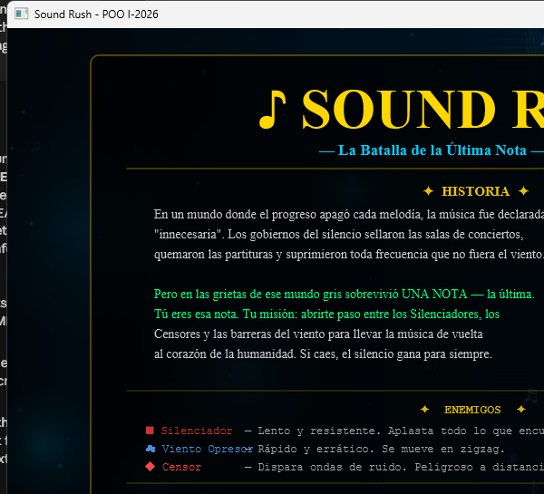
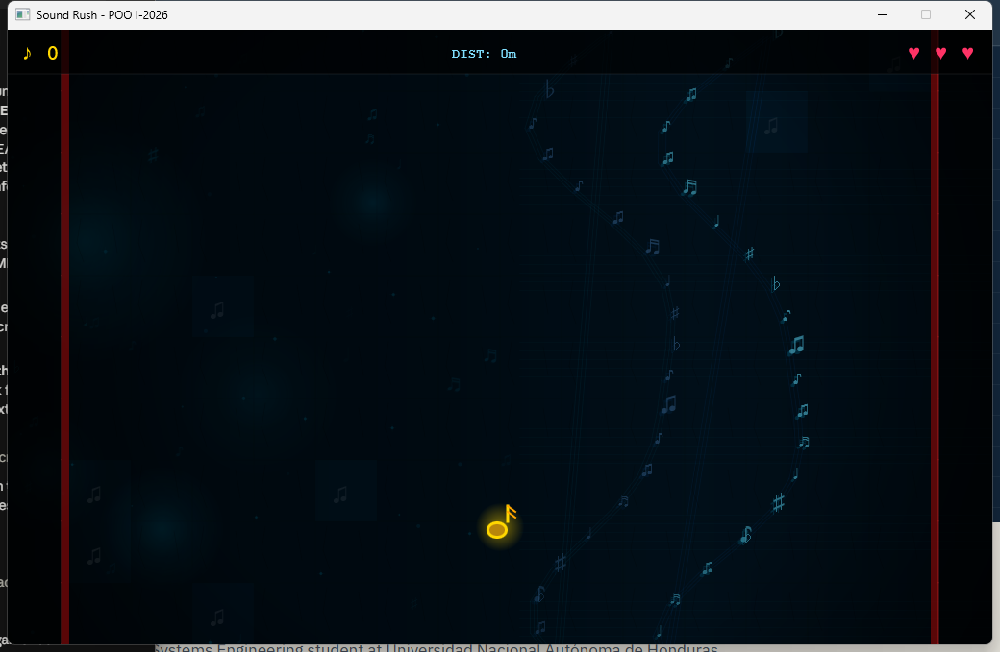

# Sound Rush — POO I-2026

A vertical-scrolling 2D game built in Java + JavaFX.
Music fights to survive in a world that has outlawed silence.



> In a world where progress silenced every melody, music was declared "unnecessary." Governments of silence sealed the concert halls, burned the sheet music, and suppressed every frequency but the wind. But in the cracks of that gray world, one note survived — the last one. You are that note. Your mission: fight through the Silencers, the Censors, and the walls of wind to bring music back to the heart of humanity.

## Gameplay



## Requirements
- Java 21 LTS (Temurin)
- Maven 3.9+
- VS Code with the "Extension Pack for Java" (optional, for the editor workflow below)

## How to run

### Option A — Maven (recommended)
```bash
mvn javafx:run
```

### Option B — VS Code
Open the `soundrush` folder in VS Code, go to `App.java`, and press the **Run** button above `main`.

## Controls
| Key | Action |
|-------|--------|
| ↑ / W | Move up |
| ↓ | Move down |
| ← / A | Move left |
| → / D | Move right |
| SPACE | Fire sound wave |
| ENTER | Confirm / Start game / Return to menu |
| R | Restart (on Game Over) |
| S | View high scores (Menu / Game Over) / Move down (in-game) |

## Enemies
- **Silenciador** — slow and tough, crushes anything in its path.
- **Viento Opresor** — fast and erratic, moves in a zigzag.
- **Burbuja Shhh** — a bubble that traps the player.
- **Censor** — fires projectiles from a distance.

## Project structure
```
soundrush/
├── pom.xml
└── src/main/java/
    ├── module-info.java
    └── com/unah/soundrush/
        ├── App.java                  ← Main game loop
        ├── clases/
        │   ├── ObjetoJuego.java      ← Abstract base class
        │   ├── ElementoMovil.java    ← Extends ObjetoJuego
        │   ├── Jugador.java          ← Extends ElementoMovil
        │   ├── Enemigo.java          ← Abstract, extends ElementoMovil
        │   ├── Proyectil.java        ← Extends ElementoMovil
        │   ├── ItemBonus.java        ← Extends ObjetoJuego
        │   ├── Obstaculo.java        ← Extends ObjetoJuego
        │   ├── Tile.java             ← Extends ObjetoJuego
        │   └── Animacion.java
        ├── enemigos/
        │   ├── Silenciador.java      ← Extends Enemigo (slow, tough)
        │   ├── VientoOpresor.java    ← Extends Enemigo (zigzag, fast)
        │   ├── BurbujaShhh.java      ← Extends Enemigo (traps the player)
        │   └── Censor.java           ← Extends Enemigo (fires projectiles)
        └── ui/
            ├── GestorMapa.java       ← TileMap + scroll + generation
            ├── GestorPuntuaciones.java ← Top 10 scores, persisted to a .txt file
            └── HUD.java              ← On-screen interface
```

## Built on top of a course base project
Extends the professor-provided base project for POO-I2026, building on:
- The `App.imagenes` structure (`HashMap<String, Image>`) and `cargarImagenes()` from the base pattern
- The base `Jugador`, `Tile`, `Animacion`, and `Item` classes
- The `AnimationTimer` pattern and key handling via static booleans in `App`

Sprites live under `src/main/resources/com/unah/soundrush/` as `.png` files. If a sprite is missing, the entity falls back to shape-based rendering.

## OOP concepts applied
- **Inheritance:** ObjetoJuego → ElementoMovil → Jugador / Enemigo → Silenciador / VientoOpresor / Censor
- **Abstract classes:** ObjetoJuego, Enemigo
- **Method overloading:** `Animacion.calcularFrame(double t)` / `calcularFrame(int indice)`
- **Method overriding:** `pintar()`, `actualizar()`, `mover()` in each subclass
- **Collections:** `ArrayList` for enemies/projectiles, `HashMap` for scores
- **File I/O:** `GestorPuntuaciones` reads/writes `puntuaciones.txt`
- **Graphics:** JavaFX Canvas, AnimationTimer, Stage/Scene
- **TileMap:** 2D tile matrix with vertical scrolling
